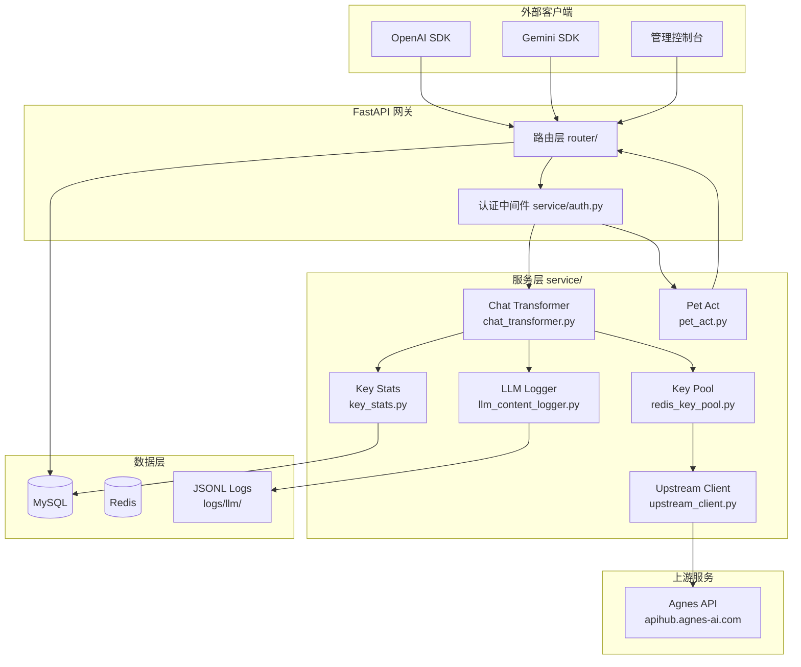
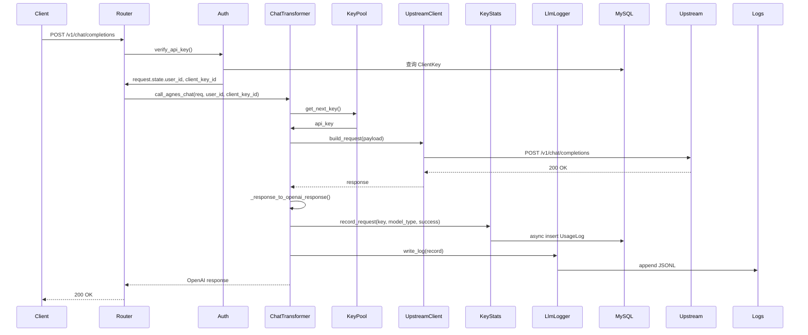

# Agnes2API 架构设计

## 系统概述

Agnes2API 是一个 OpenAI/Gemini 兼容的 Agnes AI 中转服务。它接收标准的 OpenAI/Gemini API 请求，转换为 Agnes 厂商格式后转发给上游模型，并将响应转换回 OpenAI/Gemini 兼容格式返回给客户端。

**目标用户**：需要使用 Agnes AI 模型但希望使用 OpenAI/Gemini 标准接口的开发者。

**核心价值**：
- 统一 OpenAI/Gemini 接口与 Agnes 模型的桥接
- 支持多 Key 负载均衡与自动降级
- 提供用量统计、速率限制、配额管理
- 集成桌面宠物 AI 行为决策

## 技术栈

| 类别 | 选择 |
|------|------|
| 语言与运行时 | Python 3.11+ |
| Web 框架 | FastAPI + Uvicorn |
| ORM | SQLAlchemy 2.0 (async) |
| 数据库 | MySQL (aiomysql) |
| 缓存 | Redis |
| 依赖注入 | FastAPI Depends |
| 配置管理 | Pydantic Settings |

## 项目结构

```
workspace/
├── main.py                    # 应用入口，FastAPI 初始化，lifespan 生命周期
├── config.py                  # 配置管理（Pydantic Settings）
├── requirements.txt           # Python 依赖
├── Dockerfile                 # 容器化配置
├── docker-compose.yml         # 本地开发编排
├── router/                    # HTTP 路由层
│   ├── chat.py                # OpenAI Chat Completions
│   ├── completions.py         # OpenAI Completions（文本补全）
│   ├── images.py              # OpenAI Images 生成
│   ├── responses.py           # OpenAI Responses API
│   ├── gemini.py              # Google Gemini 兼容接口
│   ├── video.py               # 视频生成
│   ├── key_pool.py            # Key 池管理
│   ├── management.py          # 管理后台 API
│   ├── system.py              # 系统状态
│   ├── models.py              # 模型列表
│   ├── proxy.py               # 图片代理
│   └── frontend.py            # 前端静态文件
├── service/                   # 业务逻辑层
│   ├── auth.py                # API Key 认证
│   ├── chat_transformer.py    # Chat 请求/响应转换（核心）
│   ├── llm_content_logger.py  # LLM 内容日志
│   ├── upstream_client.py     # 上游 HTTP 客户端封装
│   ├── key_stats.py           # Key 用量统计
│   ├── redis_key_pool.py      # Redis Key 池管理
│   ├── rate_limit.py          # 速率限制
│   ├── model_guard.py         # 模型权限校验
│   ├── pet_act.py             # 宠物行为决策
│   ├── cache.py               # 请求缓存
│   └── ...
├── models/                    # 数据模型层
│   ├── database.py            # SQLAlchemy 模型定义
│   ├── openai.py              # OpenAI 响应模型
│   ├── openai_chat.py         # Chat 请求/响应模型
│   ├── video.py               # 视频模型
│   └── migrations.py          # 数据库迁移
├── utils/                     # 工具模块
│   └── http_client.py         # httpx 客户端封装
├── frontend/                  # Vue 前端管理台
│   ├── src/
│   │   ├── components/        # 组件（含 candy-pet）
│   │   ├── stores/            # Pinia 状态管理
│   │   └── views/             # 页面视图
│   └── package.json           # 前端依赖
├── .monkeycode/               # 项目配置与规格
│   ├── specs/                 # 功能规格
│   └── docs/                  # 项目文档
└── logs/                      # 运行日志输出
    └── llm/                   # LLM 请求内容日志
```

## 子系统

### 1. 请求路由层 (`router/`)
**目的**: 接收 HTTP 请求，调用服务层处理，返回响应。
**位置**: `router/`
**关键文件**: `chat.py`, `completions.py`, `gemini.py`, `responses.py`
**依赖**: `service/auth.py`, `service/chat_transformer.py`
**被依赖**: `main.py`（注册路由）

### 2. 认证与鉴权 (`service/auth.py`)
**目的**: 验证 API Key，设置 request.state，执行速率限制。
**位置**: `service/auth.py`
**关键功能**: 
- 支持 Bearer Token / x-goog-api-key / x-api-key
- Redis 缓存认证结果（5 分钟 TTL）
- 速率限制（per-user）
**被依赖**: 所有 router

### 3. LLM 转换层 (`service/chat_transformer.py`)
**目的**: 将 OpenAI/Gemini 请求转换为 Agnes 格式，将 Agnes 响应转换回 OpenAI/Gemini 格式。
**位置**: `service/chat_transformer.py`
**关键函数**: 
- `call_agnes_chat()` - 非流式调用
- `call_agnes_chat_stream()` - 流式调用（SSE）
**依赖**: `service/upstream_client.py`, `service/redis_key_pool.py`
**被依赖**: `router/chat.py`, `router/completions.py`, `router/responses.py`, `router/gemini.py`

### 4. Key 池管理 (`service/redis_key_pool.py`)
**目的**: 管理多个上游 API Key，实现负载均衡与自动降级。
**位置**: `service/redis_key_pool.py`
**关键功能**:
- 加权轮询负载均衡
- 健康检查与自动禁用失败 Key
- 定时全量 Key 校验

### 5. 用量统计 (`service/key_stats.py`)
**目的**: 记录每次请求的用量，写入 MySQL，支持每日重置。
**位置**: `service/key_stats.py`
**依赖**: `models/database.py` (UsageLog)
**被依赖**: `service/chat_transformer.py`

### 6. 桌面宠物 (`frontend/src/components/candy-pet/`)
**目的**: 在管理台展示桌面宠物，使用 LLM 决策行为。
**位置**: `frontend/src/components/candy-pet/`
**关键文件**: `CandyPet.vue`, `usePetDrag.ts`, `pet-store.ts`
**依赖**: `service/pet_act.py`（本地调用 LLM 决策）

## 架构图



## 关键流程

### Chat Completion 流程



## 设计决策

### 1. Key 池自动降级
- **决策**: 失败 Key 自动禁用，定时健康检查恢复
- **理由**: 减少人工干预，提高服务可用性
- **实现**: `service/redis_key_pool.py` + `service/key_validation_scheduler.py`

### 2. 异步日志写入
- **决策**: LLM 内容日志使用 asyncio.create_task 后台写入
- **理由**: 避免 I/O 阻塞主流程，影响响应延迟
- **实现**: `service/llm_content_logger.py`

### 3. 流式响应累积
- **决策**: 流式请求日志在完成后一次性写入完整 output
- **理由**: 避免写入大量小块数据，减少 I/O 次数
- **实现**: `call_agnes_chat_stream()` 内部累积 delta.content

### 4. 请求内容完整保留
- **决策**: input/output 不截断，完整记录
- **理由**: 便于问题排查与行为审计
- **实现**: `chat_transformer.py` 直接序列化 payload 和 result
