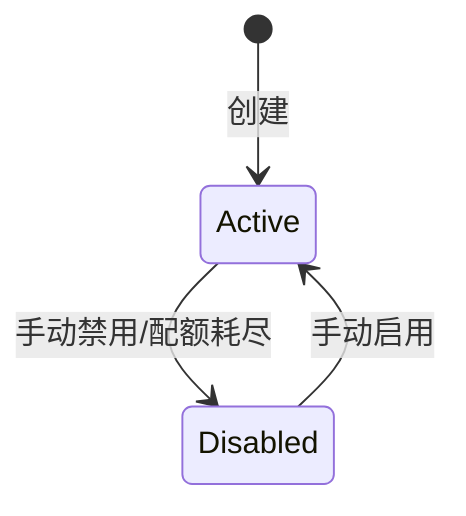

# ClientKey

## 概述

客户端 API Key，用于身份认证和配额管理。

## 数据库表

`client_keys` 表，对应模型 `models/database.py::ClientKey`

## 结构

```python
class ClientKey(Base):
    __tablename__ = "client_keys"
    
    id = Column(Integer, primary_key=True)
    user_id = Column(Integer, ForeignKey("users.id"))
    key = Column(String(100), unique=True)
    name = Column(String(100))
    status = Column(String(20), default="active")
    quota = Column(Float, default=-1.0)  # -1 表示无限
    used_quota = Column(Float, default=0.0)
    created_at = Column(DateTime)
```

## 生命周期



## 关系

- 属于 `User`（一对一）
- 关联 `UsageLog`（一对多）
