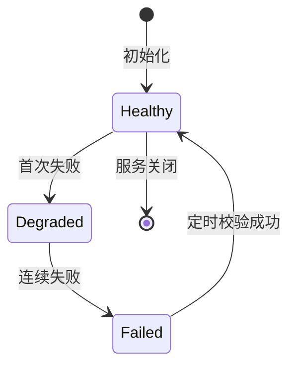

# KeyPool

## 概述

上游 Key 池管理器，实现负载均衡与自动降级。

## 实现

`service/redis_key_pool.py::KeyPoolManager`

## 核心方法

```python
class KeyPoolManager:
    async def initialize(keys: list[dict]) -> None
    async def get_next_key() -> str | None
    async def record_success(key: str) -> None
    async def record_failure(key: str) -> None
    async def start_health_checker() -> None
    async def stop_health_checker() -> None
```

## 负载均衡算法

加权轮询（Weighted Round-Robin）

## Key 状态机


