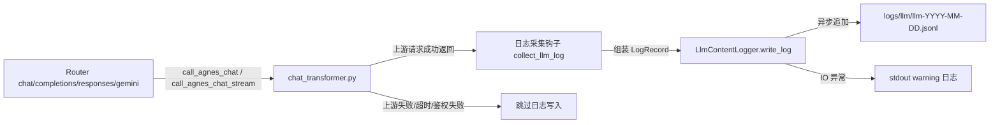

# LLM 请求内容日志持久化

Feature Name: llm-request-logging
Updated: 2026-08-14

## Description

为 Agnes2API 中转服务增加 LLM 请求输入/输出内容的 JSONL 文件日志持久化能力。所有经 `service/chat_transformer.py` 的 `call_agnes_chat`（非流式）与 `call_agnes_chat_stream`（流式）成功完成的 LLM 调用，将完整记录用户输入内容与 LLM 输出内容到按天滚动的 JSONL 文件中，仅记录成功请求，写入失败不影响主流程。

## Architecture



日志采集点集中在 `chat_transformer.py` 的两个核心函数内部，而非各路由层。原因：所有 4 个路由（chat/completions/responses/gemini）均复用这两个函数，集中埋点可保证单一数据源、零遗漏，且无需逐路由改造。`endpoint` 字段通过新增函数参数由路由层传入，标识调用来源。

## Components and Interfaces

### 1. 新增模块 `service/llm_content_logger.py`

独立的日志写入服务，负责 JSONL 文件管理、并发控制与异步写入。

**接口：**

```python
class LlmContentLogger:
    def write_log(self, record: dict) -> None:
        """异步追加一条日志记录到当天 JSONL 文件。

        - record: 已组装完成的日志字典，包含 timestamp/request_id/user_id/
                  client_key_id/endpoint/stream/model/input/output/duration_ms/
                  upstream_key_prefix 等字段。
        - 通过 asyncio.create_task 后台执行文件写入，立即返回不阻塞。
        - 写入失败仅记录 stdout warning，不抛异常。
        """
```

**关键设计：**
- 模块级单例 `get_llm_content_logger()`，跟随进程生命周期。
- 文件句柄按"当天日期"缓存，跨天时自动关闭旧句柄并打开新文件。
- 使用 `asyncio.Lock` 保证同一文件内多条记录顺序追加，避免行交错。
- 目录 `logs/llm/` 在首次写入时通过 `os.makedirs(exist_ok=True)` 自动创建。
- 当 `settings.llm_content_log_enabled` 为 False 时，`write_log` 直接 return，跳过所有逻辑。

### 2. 改造 `service/chat_transformer.py`

在 `call_agnes_chat` 与 `call_agnes_chat_stream` 中增加日志采集逻辑。

**函数签名变更：**

```python
async def call_agnes_chat(
    req: ChatCompletionRequest,
    user_id: int = 0,
    client_key_id: int | None = None,
    endpoint: str = "/v1/chat/completions",
) -> dict[str, Any]:
    ...

async def call_agnes_chat_stream(
    req: ChatCompletionRequest,
    user_id: int = 0,
    client_key_id: int | None = None,
    endpoint: str = "/v1/chat/completions",
) -> AsyncGenerator[str, None]:
    ...
```

新增 `client_key_id` 与 `endpoint` 两个可选参数（带默认值，向后兼容现有调用）。

**非流式采集逻辑（call_agnes_chat）：**
在成功返回 `result` 前的 `CHAT REQUEST END` 日志之后，组装 LogRecord 并调用 `logger.write_log`：
- `input` = `_build_agnes_payload(req)` 的完整 payload（含 model/messages/temperature 等）
- `output` = `result`（已转换为 OpenAI 格式的完整响应）
- `request_id` = `result.get("id")`
- `duration_ms` = `total_elapsed`
- `upstream_key_prefix` = `full_key[:8]`

**流式采集逻辑（call_agnes_chat_stream）：**
在流式生成器内部累积输出内容：
- 维护 `accumulated_content`、`accumulated_reasoning`、`accumulated_tool_calls`、`finish_reason` 字段
- 每个 chunk 解析时累加 delta.content 到 accumulated_content
- 流正常结束（收到 [DONE] 或 aiter_lines 自然结束且有 chunk）后，组装 LogRecord 并写入
- `request_id` = chunk_id
- `output` = `{"choices": [{"message": {"content": accumulated_content, "reasoning_content": ..., "tool_calls": ...}, "finish_reason": ...}], "usage": accumulated_usage}`

### 3. 改造各路由层

4 个路由在调用 `call_agnes_chat` / `call_agnes_chat_stream` 时传入 `client_key_id` 与 `endpoint`：

| 路由文件 | endpoint 值 | client_key_id 来源 |
|---------|-------------|-------------------|
| `router/chat.py` | `/v1/chat/completions` | `getattr(request.state, 'client_key_id', None)` |
| `router/completions.py` | `/v1/completions` | 同上 |
| `router/responses.py` | `/v1/responses` | 同上 |
| `router/gemini.py` | `/v1beta/models/{model}:generateContent` | 同上 |

### 4. 改造 `config.py`

新增配置项：

```python
# ========== LLM 内容日志配置 ==========
llm_content_log_enabled: bool = True
```

## Data Models

### JSONL 单条记录结构

```json
{
  "timestamp": "2026-08-14T15:30:00.123456+08:00",
  "request_id": "chatcmpl-a1b2c3d4e5f6",
  "user_id": 12,
  "client_key_id": 34,
  "endpoint": "/v1/chat/completions",
  "stream": false,
  "model": "agnes-2.5-flash",
  "input": {
    "model": "agnes-2.5-flash",
    "messages": [{"role": "user", "content": "你好"}],
    "temperature": 0.7,
    "max_tokens": 1024
  },
  "output": {
    "id": "chatcmpl-a1b2c3d4e5f6",
    "object": "chat.completion",
    "created": 1755000000,
    "model": "agnes-2.5-flash",
    "choices": [{"index": 0, "message": {"role": "assistant", "content": "你好！有什么可以帮你的吗？"}, "finish_reason": "stop"}],
    "usage": {"prompt_tokens": 5, "completion_tokens": 12, "total_tokens": 17}
  },
  "duration_ms": 1234,
  "first_chunk_ms": null,
  "upstream_key_prefix": "sk-xxxxx"
}
```

**字段说明：**

| 字段 | 类型 | 说明 |
|------|------|------|
| timestamp | string | ISO8601 本地时间，含微秒与时区 |
| request_id | string | 上游响应 id（非流式）或本地 chunk_id（流式） |
| user_id | int | 用户 ID，0 表示 master key |
| client_key_id | int\|null | 客户端密钥 ID，master key 时为 null |
| endpoint | string | 调用入口路由路径 |
| stream | bool | 是否流式调用 |
| model | string | 请求的模型名（含 -thinking 后缀） |
| input | object | 完整请求 payload，含 messages、model、所有参数 |
| output | object | 完整响应对象；流式为拼接后的完整响应 |
| duration_ms | float | 从请求开始到响应完成的总耗时（毫秒） |
| first_chunk_ms | float\|null | 流式首 chunk 耗时，非流式为 null |
| upstream_key_prefix | string | 上游 Key 前 8 字符脱敏值 |

## Correctness Properties

1. **仅成功请求写入**：日志写入点位于上游 HTTP 成功（2xx）且响应解析完成之后；任何异常路径（连接失败、4xx/5xx、解析错误）均不触发写入。
2. **内容完整性**：`input.output` 保留原始结构不截断、不转换，messages 数组原样保留含多模态字段；流式输出按 delta 顺序拼接为完整文本。
3. **行原子性**：单条 JSONL 记录作为完整一行写入（`json.dumps` + `\n` 一次性 write），asyncio.Lock 保证多协程并发时不交错。
4. **跨天切换**：每次写入前校验当前日期，与缓存的文件日期不符时关闭旧句柄、打开新文件，保证日志始终写入当天文件。
5. **脱敏**：upstream_key_prefix 仅保留前 8 字符，完整 Key 永不出现在日志文件中。
6. **开关即时生效**：`llm_content_log_enabled=False` 时 write_log 立即 return，不进入任何文件操作。

## Error Handling

| 场景 | 处理方式 |
|------|---------|
| 日志目录创建失败（权限/磁盘满） | stdout 输出 warning，本次跳过，后续请求重试创建 |
| 文件写入 IO 异常 | stdout 输出 warning 记录异常信息，不影响 LLM 响应返回 |
| JSON 序列化失败（罕见不可序列化对象） | catch 后用 `default=str` 兜底重新序列化，保证写入 |
| 文件句柄意外失效 | 下次写入时检测并重新打开 |
| asyncio.create_task 无事件循环 | 静默跳过，不抛异常 |

## Test Strategy

1. **单元测试**：构造 mock 的 `ChatCompletionRequest` 与响应字典，验证 LogRecord 字段组装正确性（input/output 完整性、脱敏、timestamp 格式）。
2. **非流式集成测试**：mock 上游 httpx 响应为 2xx，调用 `call_agnes_chat`，断言 JSONL 文件被创建且单行可被 `json.loads` 解析、字段齐全。
3. **流式集成测试**：mock 上游 SSE 流（多 chunk + [DONE]），调用 `call_agnes_chat_stream` 消费完毕，断言拼接后的 output.content 等于所有 delta 之和。
4. **失败请求不写入测试**：mock 上游返回 500，调用后断言 JSONL 文件不新增记录。
5. **并发写入测试**：并发触发 10 次 `write_log`，断言文件行数 = 10 且每行独立可解析（无交错）。
6. **开关测试**：`llm_content_log_enabled=False` 时断言不产生文件 IO。
7. **跨天测试**：mock 日期跨越，断言产生两个不同日期文件。

## References

[^1]: (service/chat_transformer.py) - LLM 调用核心，日志采集埋点位置
[^2]: (router/chat.py#L74) - 非流式调用入口，需传入 client_key_id/endpoint
[^3]: (router/chat.py#L64) - 流式调用入口
[^4]: (service/key_stats.py#L220) - 现有 UsageLog 异步写入模式参考（asyncio.create_task）
[^5]: (config.py#L81) - 配置项接入位置（model_config env_file）
[^6]: (models/migrations.py) - 暂无需迁移（JSONL 文件方案不涉及数据库表）
